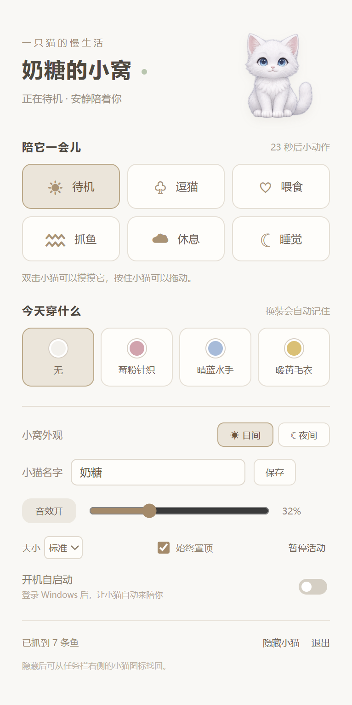
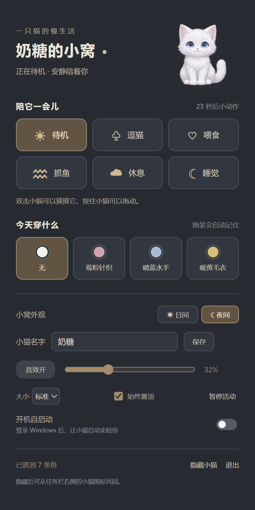

# E-PET · 白猫桌宠

一只可以陪你玩、换衣服、自己抓鱼的纯白小猫，适用于 Windows x64。

**[下载 E-PET.exe](https://github.com/sudmeet-gif/E-PET/releases/latest) · [使用说明](docs/使用说明.md) · [验收记录](TEST_RESULTS.md)**

双击 EXE 即可运行。默认名字是“奶糖”，默认不穿衣服；名字和穿着都可以在小窝里修改。

## 功能

- 透明、无边框、可置顶的桌面窗口，可拖动，透明区域点击穿透。
- 待机、逗猫、喂食、抓鱼、休息、睡觉；双击小猫可以摸摸它。
- 待机每 30 秒随机触发十种小动作：舔爪、洗脸、打滚、伸懒腰、小扑跳、摇尾巴、左顾右盼、踩奶、打哈欠、举爪撒娇。
- 休息／睡觉使用独立的轻柔动作池，只会睡梦伸腰、翻身、蜷身蹭蹭，随后继续睡眠。拖动或摸摸不会叫醒它。
- 小猫自己观察、探爪、扑抓小鱼，随机成功或失败，成功会叼起小鱼并累计数量。
- 无、莓粉针织、晴蓝水手、暖黄毛衣四种穿着，每种包含 36 张 512×512 透明姿势图。
- 小窝支持日间／夜间模式、改名、音量、静音、大小、置顶、暂停和开机自启动。自启动默认关闭。
- 托盘支持显示／隐藏、切换动作、暂停和退出。设置会自动保存。

| 日间模式 | 夜间模式 |
| --- | --- |
|  |  |

## 运行

从 [Releases](https://github.com/sudmeet-gif/E-PET/releases) 下载 `E-PET.exe`，放在喜欢的位置，双击运行。全部素材和音效都随程序提供，运行时不需要联网，也不需要安装开发环境。

开启自启动后，请保留 EXE 的名称和位置；移动文件后，可从新位置启动，再关闭、开启一次自启动开关。

设置优先保存在用户应用数据目录的 `WhiteKittenCompanion` 文件夹。该位置不能可靠保存时，使用 EXE 旁的隐藏文件夹“白猫桌宠数据”。

## 从源码构建

推荐在 Windows x64 使用 Node.js 24：

```powershell
npm ci
npm test
npm run package
```

产物位于项目旁的 `kitten-package/E-PET.exe`。本次使用 Electron 42.0.0、electron-builder 26.10.0、sharp 0.34.5；依赖版本记录在锁文件中。

仓库已包含处理好的透明图片和音频。修改原始图集或音效后，可以重建：

```powershell
node scripts/build-assets.cjs
node scripts/build-audio.cjs
```

`assets/source/generation-prompts.json` 记录图片提示词。美术采用 AI 生成的关键姿势，搭配短过渡播放；喵叫、进食、呼噜、水声等是随包提供的原创合成音效。

## 结构

| 文件 | 用途 |
| --- | --- |
| `main.cjs` | 透明窗口、托盘、位置、启动登记、设置保存 |
| `engine.cjs` | 常驻状态、互动计时、随机动作和自动抓鱼结果 |
| `pet.js` | 高清姿势播放、透明命中、拖动、抓鱼演出和声音 |
| `panel.*`、`theme.css` | 中文小窝面板、换装、日夜模式与设置 |
| `settings.cjs` | 输入校验、原子保存和可写目录探测 |
| `assets/frames` | 四种穿着各 36 张归一化透明图 |
| `assets/source` | 原始图集和生成提示词 |
| `assets/audio` | 六种本地 WAV 音效 |
| `tests` | 计时、睡眠、暂停、切换、抓鱼和持久化行为测试 |

## 开发与验收

`KITTEN_PROFILE` 可指定隔离测试配置目录。`KITTEN_DEBUG_PORT` 仅在显式设置时开放本机回环调试端口；正常运行不设置此项。`KITTEN_SHOW_PANEL=1` 可在测试启动时打开小窝面板。

`scripts/qa-runtime.cjs` 和 `scripts/qa-packaged.cjs` 用于连接已有测试实例。可以通过 `KITTEN_QA_OUTPUT` 指定报告输出位置，通过 `KITTEN_QA_EXE` 指定被测 EXE 路径。

本机已完成 Windows 11 x64 下的真实桌面和打包启动检查，详情见 [验收记录](TEST_RESULTS.md)。尚未逐一验证其他 Windows 版本、所有多屏和 DPI 组合。动画为插画关键姿势播放，不是 Live2D／骨骼模型。应用未配置个人代码签名证书。

代码采用 [MIT 许可](LICENSE)。Electron 的第三方许可随运行组件提供。
